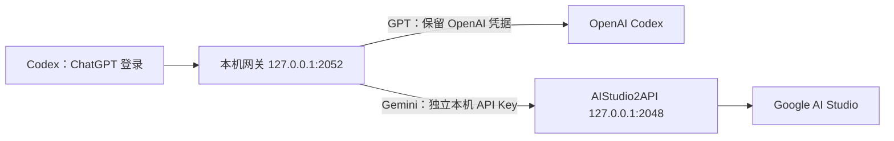

# Codex Gemini Gateway

**将 Gemini 接入 Codex，让 GPT 与 Gemini 在同一个模型菜单中使用。**

这是从一次真实 macOS 部署整理出的本机网关：保留 Codex 的 ChatGPT 登录，将 GPT 请求转发给 OpenAI，将 Gemini 请求交给单独配置的本机 AIStudio2API。提供文本对话、工具调用和同一聊天内模型切换的兼容处理。

**状态：v0.1.0，实验性发布。** 原部署的实际 Codex 调用、工具往返与跨模型切换已通过；公开版本另有独立测试。桌面菜单显示依赖应用版本，原部署的桌面人工确认仍待完成，不能保证所有版本都能显示。详见[验证范围](docs/validation.md)。

## 工作原理



本项目解决两个问题：模型列表中加入 Gemini，以及按模型将实际请求交给正确的上游。只改模型名称或目录，不能完成实际调用。

- 当前支持 `gemini-4-neon`、`gemini-4-hydrogen`；必须先在你自己的上游账号中确认可用。
- GPT 模型及其能力元数据来自你的当前 Codex 目录，不附带他人的模型目录、账号或系统提示词。
- 处理历史工具声明重复，以及 GPT/Gemini 加密推理内容互不兼容的问题。
- 仅绑定 IPv4 回环地址；两路上游凭据分开，日志不记录请求正文和密钥。
- 不自动换模型；未知模型直接报错。

## 使用前提

1. macOS，Python 3.9+。已实测 Codex CLI `0.171.0-alpha.13`；其它版本先验证配置兼容性。
2. 已登录且可正常使用的 Codex/ChatGPT 账号。
3. 已在本机配置并启动 [AIStudio2API](https://github.com/Mag1cFall/AIStudio2API)，提供 `/v1/responses`，并设置本机 API Key。[从零准备后端](docs/backend-setup.md)。
4. 你自己的账号确实能使用两个目标 Gemini 模型。模型名称、可用性、配额和费用由上游决定；本项目不提供账号、配额或官方 Google API Key。

## 快速开始

### 1. 获取代码和本机模型目录

```sh
git clone https://github.com/Randon872/codex-gemini-gateway.git
cd codex-gemini-gateway
mkdir -p "$HOME/.codex-gemini-private"
chmod 700 "$HOME/.codex-gemini-private"
(umask 077; codex debug models > "$HOME/.codex-gemini-private/openai-models.json")
```

上一步应在**尚未切换到混合网关**、原 OpenAI 提供商正常工作的情况下执行。不要使用过期的 bundled 目录代替当前账号目录。

如果 `codex` 不在 PATH，使用本机实际 CLI 路径。此处不要把本项目放在共享或不可信的可写目录。

### 2. 生成私有配置

```sh
python3 configure.py --openai-catalog "$HOME/.codex-gemini-private/openai-models.json"
```

按提示输入**本机 AIStudio2API 的 API Key**；输入隐藏。不要输入 Google 密码或 OpenAI 登录令牌。默认后端端口 2048、网关端口 2052，可用 `--gemini-port` / `--port` 更改。

命令生成 `runtime/`：权限 700，凭据和配置文件权限 600，整个目录被 Git 忽略。它还备份当前 Codex 配置并生成离线还原脚本，**不会自动修改 Codex**。已有 `runtime/` 时拒绝覆盖，请先保留旧数据再处理。

### 3. 启动网关

```sh
python3 -B gateway.py
```

保留这个终端。确认启动无端口冲突后，在另一个终端进行下一步。按 Ctrl+C 可以停止。后端服务也必须保持运行。

### 4. 合并 Codex 配置

查看 `runtime/codex-settings.snippet.toml`，合并到 `~/.codex/config.toml`；若设置了 `CODEX_HOME`，使用其下的 `config.toml`。

- `model_provider`、`model_catalog_json` 必须位于第一个 `[表]` 之前。
- 原文件有同名根设置时**替换**，不要重复添加。
- 提供商相关表追加在现有表后；已有同名表时先人工合并。
- 保留原来的 `model` 与 `model_reasoning_effort`，避免改变 GPT 默认选择。
- 不要用整个 snippet 覆盖原配置，它不包含原有插件、MCP 等设置。

然后执行版本支持检查：

```sh
codex app-server --strict-config --print-startup-config
```

若不识别相关字段或命令，先还原，不要强行尝试。不要公开粘贴完整配置或诊断输出。

### 5. 重启并验证

完全退出并重新打开 Codex，**新建聊天**后打开模型菜单。预期能看到 GPT、Gemini 4 Neon、Gemini 4 Hydrogen。旧聊天可能保留旧提供商。

先发一条普通消息，再让模型读取一个无敏感内容的测试文件，并检查 `runtime/routes.jsonl` 的 `model`、`upstream` 和 `status`。HTTP 200 只表示开始响应，应等到完整回答结束。确认 GPT 走 `openai`、Gemini 走 `gemini`。

菜单没有出现时，先排查应用是否重启、是否为新聊天、当前提供商及实际生效配置；模型列表能返回，不等于桌面 UI 已显示。

## 登录 Mac 后自启与还原

完成前台验证后，按[运维说明](docs/operations.md)安装生成的用户 LaunchAgent；不需要 sudo。不要同时运行前台进程和后台服务。

离线还原：

```sh
sh runtime/restore.sh
```

它停止本项目的后台服务，将**整份 Codex 配置**恢复到生成配置时的备份。之后新增的配置也会被覆盖，请先保留当前文件；若网关在前台运行，先 Ctrl+C。还原后重启 Codex、新建 GPT 聊天。后端和网络设置不受影响，私有运行数据仍留在本机。

## 限制与费用

- 这是第三方本机转接方案，不是 OpenAI 或 Google 官方联合产品。Google 个人会员不等于官方 Gemini API 付费额度。
- 当前适配文本与标准 Responses。图片、原生联网搜索、长对话压缩、全部插件行为尚未全面验证；Gemini 的非标准 Responses 端点会明确拒绝。
- 模型目录是本机快照；账号权限、上游目录或客户端版本变化后需要重新核对。修改目录不代表自动新增路由支持。
- 网关不修改 VPN、系统代理或防火墙，也不负责代理 Codex 的登录、插件、MCP 等全部网络请求。
- Mac 睡眠、后端退出、登录过期或上游网络故障都会影响调用；项目不承诺免费、稳定配额或规避平台限制。

## 开发与来源

```sh
python3 -B -W error::ResourceWarning -m unittest discover -s tests -v
```

Python 标准库实现，没有第三方运行依赖。测试不需要真实账号或外网模型调用。见 [安全设计](SECURITY.md)、[验证范围](docs/validation.md)、[更新记录](CHANGELOG.md)。

- [Codex 网关配置与双凭据机制](https://learn.chatgpt.com/docs/enterprise/connect-to-a-gateway)
- [Codex 网关兼容要求](https://learn.chatgpt.com/docs/enterprise/gateway-compatibility)
- [AIStudio2API](https://github.com/Mag1cFall/AIStudio2API)：单独安装、遵守其许可证；本仓库不分发它的程序或账号会话。

本项目代码采用 [MIT License](LICENSE)。
